# ROS 2 packages

> **Read this when** you create or review a ROS 2 package: its name, folder layout, linters, units, coordinate frames, launch files and parameters.

This page covers how we structure ROS 2 packages so that any lab member can build, test and reuse them. For ROS 2 itself (what nodes and topics are, installing a distribution, the command line), read [All things ROS 2](https://github.com/ATR-Lab/all-things-ros2). The one thing to remember: SI units, REP 105 frames and `colcon test` passing before you open a pull request.

## Contents

- [Naming packages](#naming-packages)
- [Package layout](#package-layout)
- [Linters with ament_lint_auto](#linters-with-ament_lint_auto)
- [Units and coordinates (REP 103)](#units-and-coordinates-rep-103)
- [Coordinate frames (REP 105)](#coordinate-frames-rep-105)
- [Launch files](#launch-files)
- [Parameters](#parameters)
- [Topics, services and interfaces](#topics-services-and-interfaces)
- [Checklist before a pull request](#checklist-before-a-pull-request)
- [Related](#related)

## Naming packages

[REP 144](https://www.ros.org/reps/rep-0144.html) sets the rules. A package name:

- uses only lowercase letters, digits and underscores, and starts with a letter;
- never has two underscores in a row, and has at least two characters;
- should not contain `ros` (every package is a ROS package);
- should have a prefix when only one organization uses it.

REP 144 also lists common suffixes: `_msgs` (interfaces), `_driver`, `_description` (URDF and meshes), `_bringup` and `_launch`. So the packages for a robot arm might be `my_arm_driver`, `my_arm_description` (its URDF) and `my_arm_bringup` (the launch files that start it).

## Package layout

### ament_cmake layout

For C++ nodes (and packages with only launch or config files). `examples/c-cpp/teleop_velocity_limiter/` follows it.

```text
teleop_velocity_limiter/
├── CMakeLists.txt
├── package.xml
├── include/teleop_velocity_limiter/   # public headers
├── src/                               # node and library sources
├── test/                              # gtest files
├── launch/                            # *.launch.py, *.launch.xml, *.launch.yaml
└── config/                            # parameter YAML files
```

### ament_python layout

For Python nodes. `ros2 pkg create --build-type ament_python <name>` generates it, including three linter tests ([tutorial](https://docs.ros.org/en/jazzy/Tutorials/Beginner-Client-Libraries/Creating-Your-First-ROS2-Package.html)).

```text
my_python_pkg/
├── package.xml
├── setup.py              # entry points for each node; install launch/ and config/ via data_files
├── setup.cfg
├── resource/my_python_pkg
├── my_python_pkg/        # the Python module, with __init__.py
├── test/                 # test_copyright.py, test_flake8.py, test_pep257.py and your tests
├── launch/
└── config/
```

Workspace repos (like the lab's [go2_ws](https://github.com/ATR-Lab/go2_ws)) keep packages under `src/`. Repos with one package put it at the root, and users clone them into their workspace's `src/`. Either way, never commit `build/`, `install/` or `log/`.

## Linters with ament_lint_auto

`colcon test` runs the linters a package declares. The usual set comes from `ament_lint_common`: copyright, cppcheck, cpplint, flake8, lint_cmake, pep257, uncrustify and xmllint. Clang-format and clang-tidy are opt-in. Declare them in `package.xml`:

```xml
<test_depend>ament_lint_auto</test_depend>
<test_depend>ament_lint_common</test_depend>
<test_depend>ament_cmake_clang_format</test_depend>
```

And in `CMakeLists.txt`, inside `if(BUILD_TESTING)` and before `ament_package()` ([ament_cmake guide](https://docs.ros.org/en/jazzy/How-To-Guides/Ament-CMake-Documentation.html)):

```cmake
if(BUILD_TESTING)
  find_package(ament_lint_auto REQUIRED)
  # The lab formats C++ with clang-format; uncrustify disagrees with it (see docs/c-cpp.md).
  list(APPEND AMENT_LINT_AUTO_EXCLUDE ament_cmake_uncrustify)
  ament_lint_auto_find_test_dependencies()
endif()
```

Notes:

- `ros2 pkg create` adds `set(ament_cmake_copyright_FOUND TRUE)` and `set(ament_cmake_cpplint_FOUND TRUE)` to new CMake packages, which skip those two linters until you add license headers. Remove the lines once your files have headers.
- For Python packages, run `ament_pep257` with the Google docstring convention; the change to `test/test_pep257.py` is in [Python](python.md#inside-ros-2-packages).
- Run everything before you push:

  ```bash
  colcon build --packages-select my_pkg
  colcon test --packages-select my_pkg
  colcon test-result --verbose
  ```

## Units and coordinates (REP 103)

[REP 103](https://www.ros.org/reps/rep-0103.html) makes robot software composable. The rules we see broken most often:

| Quantity | Unit |
|---|---|
| Length | meter |
| Angle | radian |
| Time | second |
| Mass, force | kilogram, newton |
| Linear and angular velocity | meters per second, radians per second |
| Temperature | degree Celsius |

- All frames are **right-handed**. On a robot body, **x points forward, y left, z up**.
- Outdoors, map frames use **ENU** (east, north, up).
- Camera image frames get an `_optical` suffix (z forward, x right, y down) next to the body-style frame.

Convert units at the edge of your code (the driver or the UI), never in the middle. When a vendor SDK uses degrees or millimeters, convert right where you call it and put the unit in the variable name until then (`angle_deg`).

## Coordinate frames (REP 105)

[REP 105](https://www.ros.org/reps/rep-0105.html) names the frames of a mobile robot. `map` is the parent of `odom`, and `odom` is the parent of `base_link`.

```mermaid
%%{init: {'theme':'base','themeVariables':{'primaryColor':'#003976','primaryTextColor':'#FFFFFF','primaryBorderColor':'#00295F','secondaryColor':'#EFAB00','secondaryTextColor':'#1B2533','tertiaryColor':'#F3F6FA','tertiaryTextColor':'#1B2533','lineColor':'#2C8ECD','textColor':'#1B2533','edgeLabelBackground':'#F3F6FA','clusterBkg':'#F3F6FA','clusterBorder':'#D6DEE8','titleColor':'#003976'}}}%%
flowchart LR
  earth["earth (optional, ECEF)"] --> map["map: world-fixed, no drift, may jump"]
  map --> odom["odom: continuous, drifts over time"]
  odom --> base["base_link: rigidly attached to the robot"]
  base --> sensors["sensor frames: laser, camera_link, imu_link"]
```



- `odom` → `base_link` comes from odometry (wheel encoders, visual or leg odometry). It is smooth but drifts.
- `map` → `odom` comes from localization (AMCL, SLAM). It corrects the drift and may jump.
- Each frame has one parent. Publish static sensor mounts with `robot_state_publisher` from the URDF, not from code.

## Launch files

ROS 2 launch files can be [Python, XML or YAML](https://docs.ros.org/en/jazzy/How-To-Guides/Launch-file-different-formats.html). The ROS 2 docs suggest Python when you need flexibility that XML or YAML cannot give you.

- Name them `<what>.launch.py` (or `.launch.xml`, `.launch.yaml`) and put them in `launch/`.
- Install the folder: `install(DIRECTORY launch config DESTINATION share/${PROJECT_NAME})` in CMake, or `data_files` in `setup.py`.
- Keep robot-specific values (serial ports, IP addresses, limits) in parameter files and launch arguments, not in code.
- A bringup package (`<robot>_bringup`) holds the launch files that start a whole robot; driver packages hold only their own node's launch file.

## Parameters

- Declare every parameter with a default and a unit in its name or description (`max_linear_speed`, in meters per second). See the parameter tutorials for [C++](https://docs.ros.org/en/jazzy/Tutorials/Beginner-Client-Libraries/Using-Parameters-In-A-Class-CPP.html) and [Python](https://docs.ros.org/en/jazzy/Tutorials/Beginner-Client-Libraries/Using-Parameters-In-A-Class-Python.html).
- Keep defaults safe: the slowest speed, the smallest workspace.
- Parameter files are YAML, keyed by node name, then `ros__parameters`; `/**` matches every node:

  ```yaml
  velocity_limiter:
    ros__parameters:
      max_linear_speed: 0.5   # m/s
      max_angular_speed: 1.0  # rad/s
  ```

> [!WARNING]
> Speed, force and workspace limits protect people near the robot. Changing a default limit is a safety change: say so in the pull request and have someone who knows the robot review it. Lab rules for operating robots are in the [lab safety guide](https://github.com/ATR-Lab/getting-started-atr-lab/blob/master/lab-rules/safety.md).

## Topics, services and interfaces

- Use relative names in code (`cmd_vel`, not `/cmd_vel`) so a namespace or a remap can move the node; set absolute names in launch files.
- Names are `snake_case`.
- Use standard messages (`geometry_msgs`, `sensor_msgs`, `std_srvs`) when they fit. Put custom messages, services and actions in their own `<name>_msgs` or `<name>_interfaces` package, so other packages can depend on the interfaces without the node.
- Stamp sensor data with the time it was measured and the frame it was measured in (`header.stamp`, `header.frame_id`).

## Checklist before a pull request

- [ ] Package name follows REP 144.
- [ ] `colcon build` and `colcon test` pass; `colcon test-result --verbose` shows no failures.
- [ ] Units are SI and frames follow REP 103 and REP 105.
- [ ] Parameters have safe defaults and appear in a YAML file under `config/`.
- [ ] Launch files are installed, and a README explains how to start the node (use the [README template](../templates/README.template.md)).
- [ ] `package.xml` lists every dependency, so `rosdep install --from-paths src --ignore-src -y` works on a clean machine.

## Related

- [All things ROS 2](https://github.com/ATR-Lab/all-things-ros2): ROS 2 basics, distributions and installation
- [C and C++](c-cpp.md) and [Python](python.md): style and linters for node code
- [Hardware and firmware](hardware.md): microcontrollers and wiring for robots
- ROS 2 [code style and language versions](https://docs.ros.org/en/jazzy/The-ROS2-Project/Contributing/Code-Style-Language-Versions.html), [ROS Index](https://index.ros.org/) (find an existing package before you write one)

<sub>Last reviewed: Sept. 30, 2026 · Sources checked on that date · [Suggest a change](https://github.com/ATR-Lab/dev-guidelines/issues/new)</sub>
